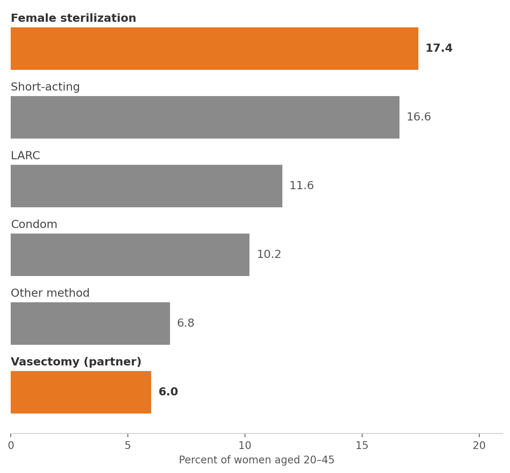
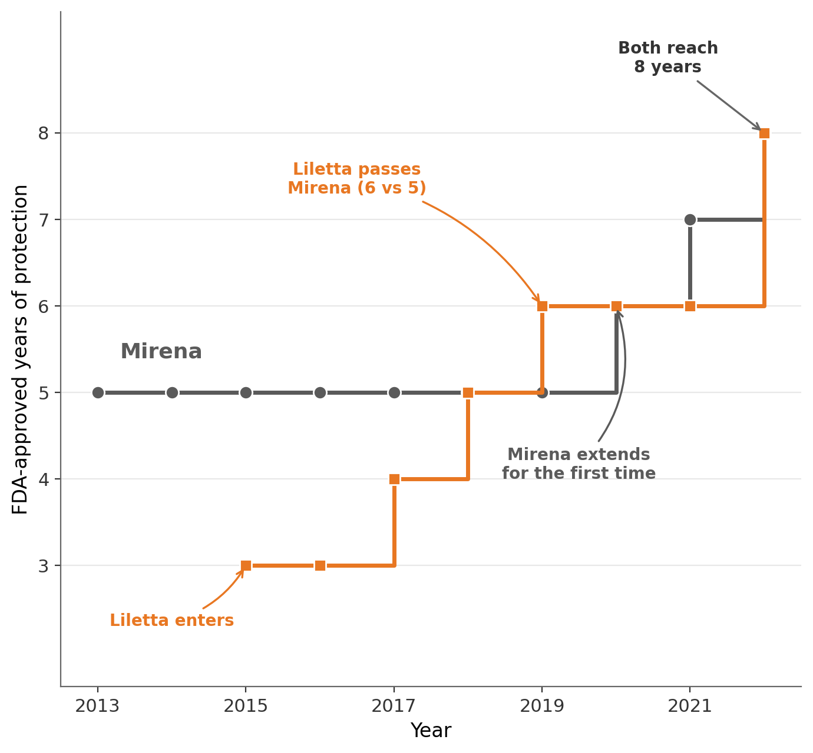

::: {.grid}

::: {.g-col-12 .g-col-md-8}

# Camille Wixon

PhD Candidate in Economics  
University of Virginia

Health Economics · Industrial Organization · Labor Economics 

[caw2va@virginia.edu](mailto:caw2va@virginia.edu) · [CV](files/Camille_Wixon_CV.pdf){target="_blank"}

I am a PhD candidate in Economics at the University of Virginia. My research is in health economics with a focus on contraceptive markets.

I am on the academic job market for 2026–2027.

:::

::: {.g-col-12 .g-col-md-4}

:::

:::

## Job Market Paper

::: {.grid}

::: {.g-col-12 .g-col-md-8}

**[The Price of Permanence: A Study of Household Contraceptive Choice including Sterilization](files/Wixon_JMP.pdf){target="_blank"}**

Last updated: November 2026

*In 2015–2017, 17.38% of women aged 20–45 relied on female sterilization for contraception, compared with 5.96% who relied on a partner's vasectomy (NSFG). Despite its prevalence, sterilization has received little attention in the economics literature. The Affordable Care Act's contraceptive mandate requires coverage of female sterilization but imposes no equivalent requirement for vasectomies, leaving men facing substantial out-of-pocket costs. Motivated by this policy asymmetry, this paper estimates household contraceptive demand using a nested logit model and MarketScan claims data on approximately 14.2 million observations from 2015–2017. Estimates reveal a strong aversion to permanent contraception, but a preference for male sterilization, with households indifferent between paying \$346 for a vasectomy and female sterilization at zero cost, holding other characteristics constant. Eliminating out-of-pocket costs for vasectomy increases predicted annual uptake 87 percent from 1.58 to 2.95 percent, with approximately 104,000 additional vasectomies among couples who would otherwise rely on less effective over-the-counter methods or use no contraception. These findings carry implications for contraceptive coverage policy, suggesting that eliminating vasectomy cost sharing can increase permanent contraceptive adoption while reducing the financial and medical burdens associated with sterilization.*

:::

::: {.g-col-12 .g-col-md-4}

Contraceptive method use among women aged 20–45, 2015–2017 (NSFG).

:::

:::

## Working Paper

::: {.grid}

::: {.g-col-12 .g-col-md-8}

**Refills and Renewals: Hassle Costs in the Contraceptive Market**

Last updated: November 2026

*After two decades, Mirena, a leading hormonal IUD in the United States, revised the approved duration of its device for the first time in 2020, following the entry of a competitor, extending the period of protection a single insertion provides without any change to the device itself. Over the same years, 21 states began allowing pharmacists to prescribe self-administered contraception without a physician visit. Both changes reduced the hassle costs associated with obtaining and maintaining contraception. I use Medicaid State Drug Utilization Data from 2015–2022 to estimate a nested logit model of contraceptive demand, exploiting the staggered adoption of state pharmacy access laws and changes in the labeled duration of intrauterine devices. I find that women value longer approved protection, with a one-year extension of Mirena's labeled duration increasing annual LARC insertions by approximately 14 percent, or 54,000 additional insertions, while extending pharmacy access nationwide increases use of eligible short-acting methods by approximately 6 percent and brings approximately 47,000 additional Medicaid women into the prescription contraceptive market annually. Finally, I examine the gap between approved duration and existing clinical evidence. Extending long-acting contraceptives to the durations supported by available evidence would generate approximately 229,000 additional annual LARC insertions, avert approximately 26,000 unintended pregnancies, and produce \$35.7 million in annual net Medicaid savings.*

<!-- Uncomment when ready: [PDF](files/Wixon_IUD.pdf){target="_blank"} -->

:::

::: {.g-col-12 .g-col-md-4}

FDA-approved duration of Mirena and Liletta, 2013–2022.

:::

:::

## Work in Progress

**Stockpiling under Political Uncertainty: Evidence from Ammunition Sales** (with Marcella Cartledge and Yiren Ding)